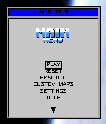
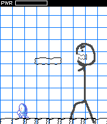
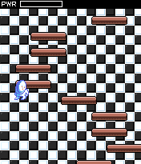
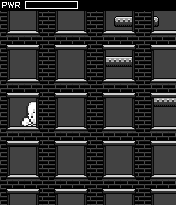
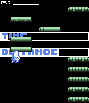
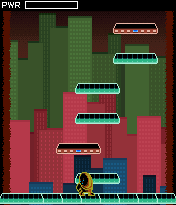

# Mad Kaz

> [!IMPORTANT]
> Mad Kaz was a game I created for the 2007 [MOTODEV Game Developer Challenge](https://www.pocketgamer.com/motodev-game-dev-challenge/). To read more about it and its development, check out [Things I've tried: Becoming an Indie Gamedev](https://offbynull.com/posts/motodev%20game%20development%20contest/index.html).

Mad Kaz is a vertical platformer where you lead the title character through a series of unique levels, each crazier than the last. Mad Kaz features six zones with between four to ten levels per zone, and eight different game modes.  Built on top of a unique engine, Mad Kaz allows users to create their own levels with customized game play, cinematics, music, and style.  Levels can be uploaded onto phones via either Bluetooth or the Internet.

      
